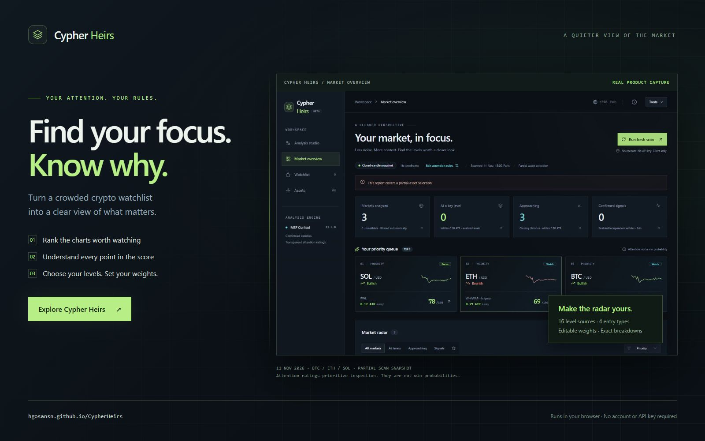

# Cypher Heirs

### Know which charts deserve a closer look.

Cypher Heirs turns a crowded crypto watchlist into a clear view of what deserves your attention. Discover markets approaching meaningful price levels, understand why they rank, and shape the radar around your own trading interests.

**[Open Cypher Heirs →](https://hgosansn.github.io/CypherHeirs/)** · [Documentation](docs/README.md) · [Releases](https://github.com/hgosansn/CypherHeirs/releases)

## A quieter view of the market

- **Find your focus.** A ranked priority queue brings nearby levels and recent confirmed entries into view.
- **Understand every rating.** Inspect the candles, references and exact contributions behind each score.
- **Make the rules your own.** Toggle levels and entry types, tune their weights, and preview the effect in Analysis studio.
- **Build your workspace.** Edit your asset universe, pin markets and keep saved scans and preferences in your browser.

Built for Binance USDT perpetual markets. Runs in your browser, with no account or API key required.

Attention ratings prioritize inspection; they are not win probabilities or automated trade recommendations.

## Explore further

[User guide](docs/user-guide.md) · [How attention works](docs/attention-engine.md) · [Data and privacy](docs/data-and-privacy.md) · [Development](docs/development.md) · [Changelog](docs/CHANGELOG.md)

[Licensing and provenance](docs/licensing.md) · [Third-party notices](THIRD_PARTY_NOTICES.md)
